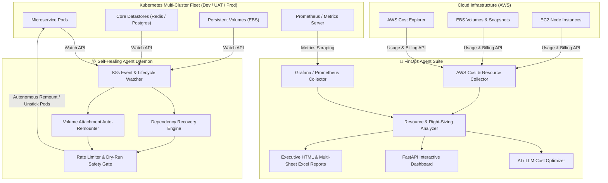

# ⚡ Kubernetes Autonomous Agents: FinOps & Self-Healing Platform

<p align="center">
  
</p>

<p align="center">
  <strong>Production-grade intelligent agents for automated Kubernetes cost optimization, real-time observability, and self-healing cluster reliability.</strong>
</p>

<p align="center">
  
  
  
  
  
  
</p>

---

## 📖 Overview

Modern cloud-native Kubernetes environments face two persistent operational challenges:
1. **Cloud Cost Creep & Resource Waste**: Over-provisioned pod requests, idle compute nodes, unattached EBS volumes, and stale snapshots silently inflate monthly cloud spend.
2. **Transient Cluster Startup Bottlenecks**: In dynamic or cost-optimized dev/staging clusters where nodes scale to zero overnight, pod startup order creates cascading failure states — Persistent Volumes get stuck attaching, and dependent microservices enter prolonged exponential `CrashLoopBackOff` sleeps (up to 5 minutes) long after their upstream databases or caches are online.

This repository bundles two enterprise-tested, autonomous agents designed to solve these exact challenges:

* **🤖 FinOps Agent (`finops-agent`)**: An autonomous cloud financial engineering daemon that audits live Kubernetes clusters across multi-cluster Prometheus/Grafana instances and AWS accounts. It performs AI-powered cost-anomaly analysis, detects idle resources, generates executive HTML/Excel reports, and serves an interactive web dashboard.
* **🩺 Self-Healing Agent (`self-healing-agent`)**: An autonomous cluster reliability daemon that actively monitors pod events, resolves stuck volume mounts, and uses dependency-aware topology checking to break out of exponential CrashLoop back-offs instantly once upstream services recover.

---

## 🏗️ Architecture



---

## 🚀 Agent Modules

### 1. 🤖 FinOps Agent (`/finops-agent`)

The FinOps agent provides end-to-end visibility and actionable right-sizing recommendations across single or multi-cluster environments.

#### Key Features:
* **Multi-Cluster Grafana & Prometheus Ingestion**: Pulls granular CPU, memory, and throttling statistics across unlimited named clusters.
* **AWS Cloud Waste Detection**: Scans for unattached EBS volumes, aged snapshots (>90 days), idle EC2 instances, and untagged resources.
* **AI-Powered Financial Recommendations**: Leverages LLMs (via LiteLLM / OpenAI / Anthropic) to synthesize cluster metrics into executive summaries and prioritized cost-reduction roadmaps.
* **Executive Multi-Tab Excel & HTML Reports**: Outputs styled executive workbooks featuring color-coded utilization gradients, cost estimates, and pod-by-pod comparisons.
* **Live Interactive Web Dashboard**: Built with FastAPI, modern responsive UI, audio feedback effects, and live metrics exploration.

#### Quickstart:
```bash
cd finops-agent

# 1. Install dependencies
pip install -r requirements.txt

# 2. Configure credentials & targets
cp config.example.yaml config.yaml
# Edit config.yaml with your Grafana URLs and AWS credentials

# 3. Run full audit & generate executive report
python main.py

# 4. Launch live web dashboard
python server.py --port 8080
```

---

### 2. 🩺 Self-Healing Agent (`/self-healing-agent`)

The Self-Healing agent eliminates manual DevOps interventions during cluster wake-ups and deployment rollouts.

#### Key Features:
* **Dependency-Aware CrashLoop Back-off Bypass**: When microservices crash because a cache (e.g. Redis) or database is not yet ready, Kubernetes enforces exponential back-off delays up to 300 seconds. The agent monitors upstream health and immediately restarts downstream pods the moment upstream dependencies pass readiness checks.
* **Stuck Persistent Volume Auto-Recovery**: Detects pods stuck in `Pending` due to `FailedMount` or `FailedAttachVolume` timeouts (>5 min) and gracefully cycles the pod to trigger Kubernetes volume re-attachment.
* **Capacity Constraint Warnings**: Distinguishes between software failure and physical resource exhaustion (`Insufficient cpu` / `Insufficient memory`) without causing destructive restart loops.
* **Configurable Safety Controls**:
  * `dry_run: true`: Preview all diagnostic decisions without modifying cluster state.
  * `interactive_approval: true`: Prompts operators in the terminal before restarting pods.
  * `max_healing_restarts_per_pod_hour`: Enforces hard rate limits to prevent cascading loops.

#### Quickstart:
```bash
cd self-healing-agent

# 1. Install dependencies
pip install kubernetes PyYAML

# 2. Configure watch targets
cp config.example.yaml config.yaml

# 3. Run in Dry-Run mode to audit cluster health
python agent.py --dry-run
```

---

## ☸️ In-Cluster Deployment (Kubernetes Manifest)

Deploy the Self-Healing Agent directly into your cluster as an automated daemon:

```yaml
apiVersion: apps/v1
kind: Deployment
metadata:
  name: k8s-self-healing-agent
  namespace: kube-system
  labels:
    app.kubernetes.io/name: self-healing-agent
spec:
  replicas: 1
  selector:
    matchLabels:
      app: self-healing-agent
  template:
    metadata:
      labels:
        app: self-healing-agent
    spec:
      serviceAccountName: self-healing-agent-sa
      containers:
        - name: agent
          image: python:3.11-slim
          command: ["python", "/app/agent.py"]
          volumeMounts:
            - name: config-volume
              mountPath: /app/config.yaml
              subPath: config.yaml
      volumes:
        - name: config-volume
          configMap:
            name: self-healing-agent-config
```

---

## 🔒 Security & Best Practices

* **No Hardcoded Credentials**: All authentication configurations utilize environment variables, IAM roles, or local non-tracked `config.yaml` files.
* **Least Privilege RBAC**: The self-healing agent only requires `get`, `list`, `watch`, and `delete` permissions on Pods in designated application namespaces.
* **Safe Dry-Run by Default**: Both agents support non-destructive simulation modes for pre-flight safety audits before production activation.

---

## 📄 License

This project is licensed under the [MIT License](LICENSE).
